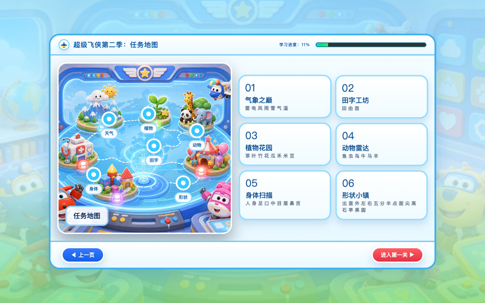
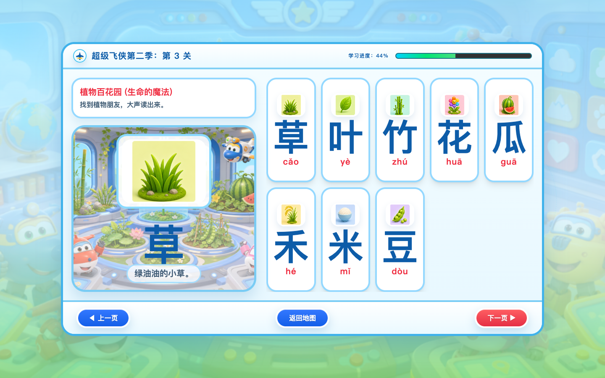
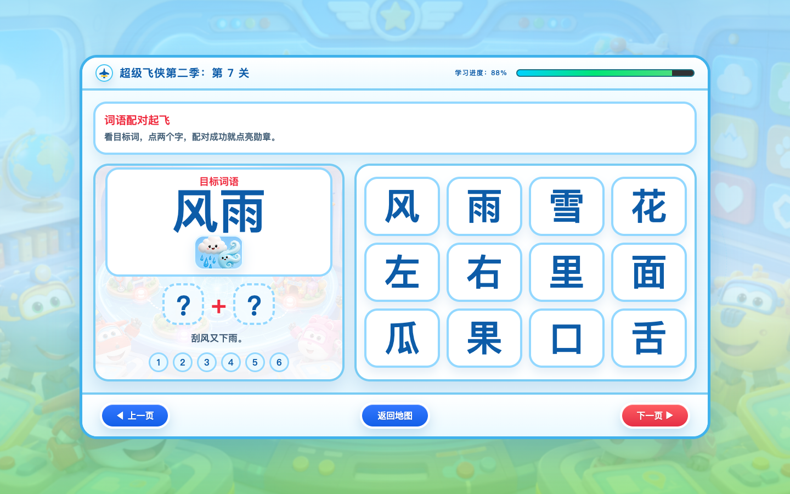

# 互动课件设计师

**把老师的教学想法，变成孩子能看、能听、能参与的互动课件。**

你可以提供一组知识点、一个单元的内容，或者已有的PPT、PDF、网页。这个skill会协助你梳理教学目标、规划页面与互动、制作图片和声音，并检查、打包成便于课堂使用的课件。

默认制作老师投屏使用的HTML课件。幼儿园、小学不同学科都可以使用，主题和玩法根据学生年龄与教学内容调整。

## 安装到 Codex

把本仓库克隆到本机 Codex 的 skills 目录：

```bash
git clone https://github.com/NickQi688/interactive-lesson-designer.git ~/.codex/skills/interactive-lesson-designer
```

如果目录已经存在，不要覆盖原有修改。当前仓库为私有仓库，克隆需要有访问权限的GitHub账号。安装后在新对话中输入 `$interactive-lesson-designer` 调用。

核心指令见 [SKILL.md](SKILL.md)，详细方法位于 [references](references)。案例截图随仓库保存，无需原始课件文件。

## 用一个实际案例认识它

下面展示的是“超级飞侠汉字任务”课件的真实页面，用来说明设计方法。它不是每次都必须套用的模板，也不代表新课件一定采用相同角色或画风。

### 1. 用一个情境，让孩子愿意开始


这个案例把复习包装成一次任务：进入控制大厅，点击开始。首页保留清楚的主题与入口，减少操作说明，让老师几句话就能带孩子进入活动。

换成数学课，可以是“修复时钟小镇”；换成科学课，可以是“植物观察站”。主题的作用是串起学习活动，具体名称与画面可以重新设计。

### 2. 把内容组织成看得懂的路径



地图把一组复习内容分成若干任务，老师可以选择要复习的部分，再进入学习。

地图只是其中一种组织方式。内容较少时可以直接进入活动；讲解型课程可以采用故事章节或目录，不必每节课都闯关。

### 3. 让字、图和声音共同帮助理解



这页把汉字与对应图片放在一起，点击卡片可以切换展示内容并播放读音。老师可以先让孩子认读，再借助图片和声音核对。

制作时会检查字是否够大、图片是否表达正确含义、声音是否清晰，以及后排是否容易看清。拼音、图片等提示是否提前展示，要根据教学目标决定。

### 4. 给孩子一个实际参与的动作



这个案例用选字组合词语来复习，让孩子从“看过、听过”进一步尝试回忆和组合。老师可以带全班讨论，再操作选择。

其他内容可以使用分类、排序、补句、观察变化或情境选择。互动形式由学习目标决定，不能只是给每页加一个按钮。

## 它会怎样帮你制作

1. **了解需求**：确认对象、内容、学习目标、课堂使用方式、主题和设备；你已经说过的信息不会反复询问。
2. **规划方案**：整理知识点，选择合适互动，说明页面、图片、声音与交付方式。
3. **制作样板**：先做能实际点击的代表性页面，确认教学与视觉方向后再批量扩展；已明确授权完整制作时继续完成。
4. **补齐内容**：完善页面、图片、音频与反馈；工具无法生成的素材会标明，并提供提示词或可行替代方案。
5. **检查交付**：检查内容、显示、操作、声音和资源，整理入口文件与素材包，说明实际测试结果。

图片和语音生成取决于当前工具、服务与预算。skill本身提供制作流程与判断规则，不包含付费服务额度，也不自动保证所有设备兼容。

## 老师需要提供什么

最重要的是：**给谁用、教什么、希望孩子学会什么。**

有课本内容、字表、题目或旧课件可以一起提供。主题、玩法和音色拿不准也没关系，skill会给出建议。涉及教材读音、标准笔顺或答案时，需要核对来源；课堂完成奖励不等于每个孩子都已掌握。

## 直接这样开始

**识字复习：**

> 使用 $interactive-lesson-designer，帮我做一年级第一单元识字复习课件。会认字和会写字分开，老师投屏使用，希望可以离线打开。我会提供字表，你先规划方案。

**数学互动：**

> 使用 $interactive-lesson-designer，帮我设计一年级“认识钟表”的互动课件。用于15分钟课堂复习，希望孩子能辨认整时，采用探险主题，先做一个可点击的样板。

**改进已有课件：**

> 使用 $interactive-lesson-designer，检查这个HTML课件。学生在教室后排看不清，图片有变形，过关动画太快。请修复问题并检查完整流程。

## 最后拿到什么

默认是一个课件文件夹，里面有HTML入口、图片音频等素材和简短使用说明。离线版本以“解压后双击打开”为目标，交付时说明已验证的环境与限制。需要线上版本或PPT时，再按实际用途安排。

超级飞侠截图仅展示本次课件案例。后续可使用原创角色或其他可用素材；公开分发时需确认相应素材的使用范围。
